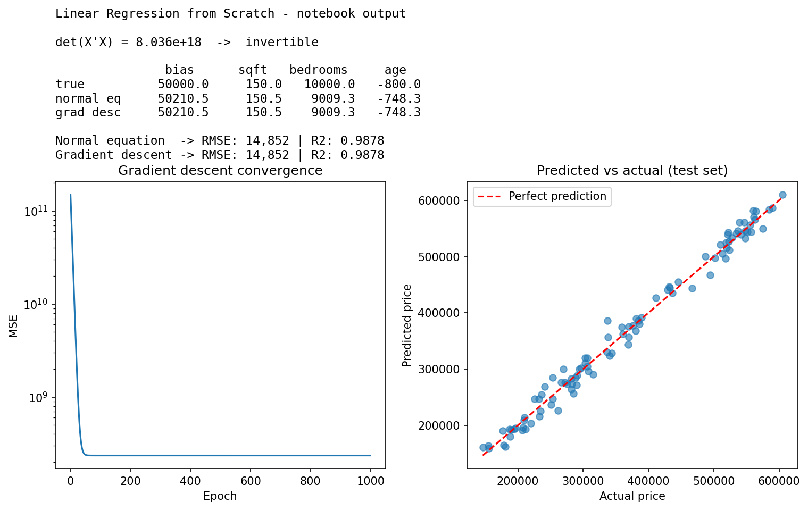

# Linear Regression from Scratch

[](https://colab.research.google.com/github/YOUR-USERNAME/YOUR-REPO/blob/main/linear_regression_from_scratch.ipynb)

Predict house prices by solving the **normal equation** and running **vectorized gradient descent**, using only matrix operations in NumPy (no scikit-learn).

## What's in the notebook

1. **Seeded housing data** generated from a known formula, so the learned coefficients can be checked against the truth
2. **Normal equation**: check that `det(XᵀX) ≠ 0`, then solve `θ = (XᵀX)⁻¹Xᵀy` with inverse and transpose
3. **Gradient descent** using the `@` operator on standardized features
4. **Evaluation** with RMSE, R² and a predicted-vs-actual plot on a held-out test set

## The data

Prices are generated with a known formula plus noise (standard deviation 15,000):

```
price = 50,000 + 150 × sqft + 10,000 × bedrooms − 800 × age + noise
```

500 houses, seeded with `np.random.seed(42)`, split 80/20 into train and test.

## Results

| Coefficient | True | Normal equation | Gradient descent |
|---|---|---|---|
| Bias | 50,000 | 50,210.5 | 50,210.5 |
| Sqft | 150 | 150.5 | 150.5 |
| Bedrooms | 10,000 | 9,009.3 | 9,009.3 |
| Age | −800 | −748.3 | −748.3 |

| Method | Test RMSE | Test R² |
|---|---|---|
| Normal equation | 14,852 | 0.9878 |
| Gradient descent | 14,852 | 0.9878 |

Both methods land on the same solution. Because the noise has a standard deviation of 15,000, an RMSE near that is about the best any model can do on this data.



## How to run

1. Click the **Open in Colab** badge above
2. Choose **Runtime > Restart and run all**
3. The outputs should match the results above, since the seed is fixed

## Tech

Python, NumPy, Matplotlib, Google Colab

## Author

Piyush Kumar
